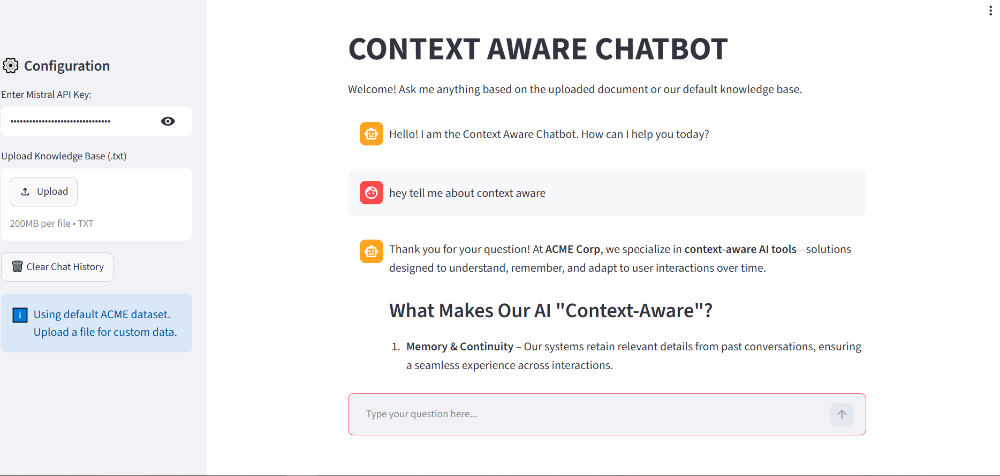

# Context-Aware RAG Chatbot — LangChain + Mistral

A Streamlit document Q&A prototype developed in Google Colab. It combines Mistral chat and embeddings, FAISS retrieval, and session conversation history to answer questions using an uploaded text document or the bundled ACME example.

This README describes the author's [original notebook](notebooks/original_context_aware_rag.ipynb) and [saved demo screenshot](assets/original_demo.png). The root `app.py` is extracted directly from the notebook's `%%writefile app.py` cell without changing its Python code.

## Original implementation

| Component | Code configuration |
|---|---|
| Chat model | `open-mistral-7b` through `ChatMistralAI` |
| Temperature | 0.2 |
| Embeddings | `MistralAIEmbeddings()` |
| Vector index | In-memory FAISS |
| Text splitting | 500 characters, 50-character overlap |
| Retrieval | Top 3 chunks (`k=3`) |
| Follow-up handling | History-aware question reformulation |
| Answer generation | Retrieved context plus chat history |
| Interface | Streamlit |
| Notebook hosting | Colab with a temporary Cloudflare tunnel |
| Training / fine-tuning | None |

## What the app does

1. Reads a Mistral API key from a password-style sidebar input.
2. Accepts a UTF-8 `.txt` document, or uses the default ACME example.
3. Splits text, embeds chunks, and creates a FAISS index.
4. Uses chat history to reformulate a follow-up as a standalone retrieval question.
5. Generates an answer using retrieved context and the conversational prompt.
6. Displays messages and retains successful turns in `st.session_state.chat_history`.
7. Clears session history when the **Clear Chat History** button is clicked.

The default fictional ACME text includes a 30-day return policy, support email and phone, and example founding details. It is demonstration material, not a real company knowledge base.

## Original demo



The screenshot shows:

- A masked API-key input, text-file uploader, and clear-history button.
- A status message indicating that the default ACME text is in use.
- The user question `hey tell me about context aware`.
- A generated answer discussing context-aware AI tools.

This is a historical manual demonstration of the interface and one response. It does not establish retrieval precision, the correctness of every generated claim, follow-up quality, or performance on uploaded documents.

## Testing and evidence in the submitted files

| Evidence | What is visible | What it does not verify |
|---|---|---|
| Notebook installation cell | Dependency installation output and dependency-conflict warnings | A clean, locked environment |
| Notebook app-generation cell | `Overwriting app.py` | Successful inference |
| Notebook launch cell | A temporary `trycloudflare.com` URL was printed | Continued availability of that URL or complete UI testing |
| Original screenshot | One question and generated answer with the default knowledge base | A multi-question benchmark or comprehensive feature tests |

There is no assertion-based automated test suite in the original notebook. The screenshot documents the author's original demonstration; it is not presented as a newly executed test.

The printed notebook statement that the tunnel ensures a perfect UI is a message in the launch script, not a measured test result.

## How to run the original project

### Google Colab workflow

1. Open `notebooks/original_context_aware_rag.ipynb` in Google Colab.
2. Run the installation cell, then the cell that writes `app.py`.
3. Run the Streamlit/tunnel launch cell.
4. Open the newly generated tunnel URL.
5. Enter your Mistral API key in the app sidebar.
6. Ask a question using the default text or upload a UTF-8 `.txt` file.

Previously printed tunnel links are temporary and should not be treated as current deployment URLs.

### Local Streamlit workflow

The extracted `app.py` can be launched with:

```bash
python -m pip install -r requirements.txt
streamlit run app.py
```

The requirements list reflects the notebook's installation commands and the text-splitter import; it is not an exact historical dependency lock. The original imports use `langchain.chains`. Dependency versions must support those imports. The saved notebook already shows dependency-conflict warnings, and current model/API availability must be checked before a fresh run. The original `open-mistral-7b` identifier has been retained rather than silently replaced.

Enter credentials only in your local app/sidebar; do not commit them. The original app assigns the key to a process environment variable. A tunnel exposes the running app at a public temporary URL.

## Scope and limitations

- History is session-based, not persistent storage or model training.
- The code passes prior messages into retrieval and generation, but no labeled test measures the benefit of memory.
- The original app does not clear old conversation history automatically when a different document is uploaded.
- The original cached initialization excludes `_api_key` from Streamlit's cache key. It is not designed as an isolated multi-user service.
- The answer prompt asks for context-based responses but does not guarantee that unsupported claims will be refused.
- Upload decoding and initialization may fail; the notebook does not implement the later assistant-added validation or bounded-history helpers.
- API calls incur provider limits/costs; retrieved content and conversation may contain sensitive information. Use demonstration text.
- No accuracy, latency, Recall@k, or clinical/enterprise readiness result is claimed.

## Original files and archived later work

```text
app.py
requirements.txt
README.md
notebooks/original_context_aware_rag.ipynb
assets/original_demo.png
archive/improved_app/
```

The original notebook and screenshot are preserved byte-for-byte as supplied. The extracted app is statically syntax-checked; this is not a fresh UI or API execution.

The later assistant-added app, helpers, tests, workflows, requirements, and their README are retained in `archive/improved_app/`. That implementation used a different chat model and had a verified live run with 3 sample checks plus 8 offline tests. Those results belong to the archived implementation, not this restored original source. Its workflow copies are outside the active root workflow directory.

## Author

**Syble Jan** — AI/ML portfolio project.
